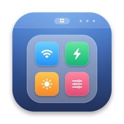
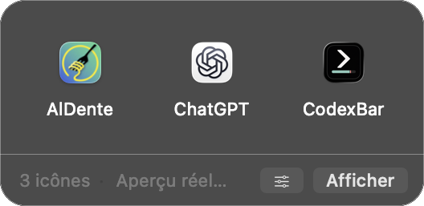
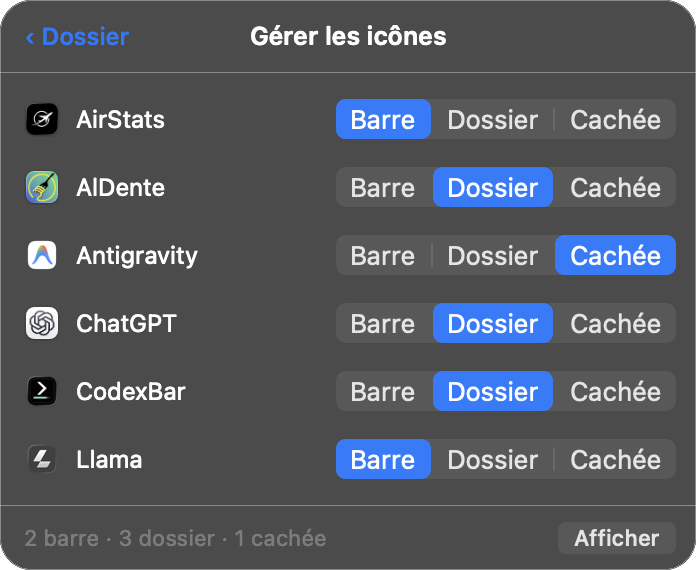

<p align="center">
  
</p>

<h1 align="center">MenuFolder</h1>

<p align="center">
  Un petit utilitaire macOS natif en Swift et AppKit pour ranger les icônes de la barre de menus dans l'équivalent d'un dossier iPhone.
</p>

<p align="center">
  <a href="https://github.com/Titouanvh/MenuFolder/releases/download/v1.0.0/MenuFolder-Launch.mp4">
    
  </a>
  <br>
  <sub><a href="https://github.com/Titouanvh/MenuFolder/releases/download/v1.0.0/MenuFolder-Launch.mp4">Voir la vidéo en 1080p avec son (MP4)</a> · <a href="assets/MenuFolder-Launch.mp4">Fichier dans le dépôt</a></sub>
</p>

<p align="center">
  &nbsp;&nbsp;&nbsp;
  
</p>

## Pourquoi cet outil

Sur un MacBook avec encoche, cinq ou six apps dans la barre de menus suffisent pour faire disparaître les icônes derrière la caméra. Je voulais un outil léger, sans dépendance externe, sans compte, sans télémétrie et sans polling permanent : une seule icône dans la barre de menus, zéro icône dans le Dock, et un dossier qui s'ouvre à la demande.

## Fonctionnalités

- Une seule icône dans la barre de menus (`LSUIElement`, absente du Dock).
- Un clic gauche ouvre une grille ancrée sous le bouton. Cliquer sur une app ouvre son menu ou son popover habituel ; un clic ailleurs ou `Échap` referme la grille.
- Un clic droit sur le bouton principal ouvre trois actions : `Gérer les icônes…`, `Afficher les icônes rangées` et `Quitter`.
- Le panneau `Gérer les icônes…` permet de choisir en un clic pour chaque icône entre `Barre` (visible dans la barre de menus), `Dossier` (rangée dans la grille) et `Cachée` (hors barre et hors grille, récupérable à tout moment).
- Un clic droit sur une tuile dans le dossier propose aussi `Ouvrir`, `Sortir dans la barre` et `Cacher du dossier`.
- Le rangement manuel fonctionne comme nativement sur macOS : activez `Afficher les icônes rangées`, maintenez `⌘` et glissez une icône à gauche du séparateur pour la ranger, ou à droite pour la ressortir.
- Quitter l'application remet toutes les icônes à leur place dans la barre de menus.
- Consommation au repos mesurée sur MacBook Air M2 sous macOS 26.6.2 (grille fermée) : `0.0 %` CPU, `0` réveil inactif (`idlew`), `18 Mo` d'empreinte mémoire physique (`footprint`).

## Installation

Prérequis : macOS 14 (Sonoma) ou plus récent. Testé sur macOS 26.6.2 (Tahoe) sur Apple Silicon.

### Option 1 : télécharger l'application compilée (recommandé)

1. Téléchargez `MenuFolder-1.0.0.zip` dans la section [Releases](../../releases/latest).
2. Décompressez l'archive et glissez `MenuFolder.app` dans `/Applications`.
3. Comme l'application est distribuée en open source avec une signature ad-hoc (sans compte Apple Developer payant), supprimez l'attribut de quarantaine Gatekeeper avant le premier lancement :

```bash
xattr -cr /Applications/MenuFolder.app
open /Applications/MenuFolder.app
```

### Option 2 : compiler depuis les sources

Seuls les Command Line Tools Apple (`swiftc`) sont nécessaires. Vous n'avez pas besoin d'installer Xcode complet.

```bash
git clone https://github.com/Titouanvh/MenuFolder.git
cd MenuFolder
./build.sh
open build/MenuFolder.app
```

Si les Command Line Tools ne sont pas encore installés sur votre Mac, lancez d'abord `xcode-select --install`.

Pour installer ensuite votre build dans `/Applications` :

```bash
cp -R build/MenuFolder.app /Applications/
open /Applications/MenuFolder.app
```

## Autorisations macOS

### Accessibilité (obligatoire)

macOS demande l'autorisation Accessibilité pour lister les icônes situées derrière le séparateur, déclencher leurs menus et les déplacer entre la barre et le dossier. Sans cette autorisation, le masquage et le menu clic droit fonctionnent quand même, et la grille propose un raccourci direct vers les réglages ainsi que le bouton `Afficher les icônes`.

Pour l'activer :

1. Cliquez sur l'icône MenuFolder dans la barre de menus, puis sur `Ouvrir Réglages…`.
2. Dans **Réglages Système > Confidentialité et sécurité > Accessibilité**, activez `MenuFolder` (ou ajoutez `MenuFolder.app` via le bouton `+`).
3. Cliquez à nouveau sur l'icône MenuFolder : le dossier est prêt.

Note après recompilation locale : une signature ad-hoc change à chaque compilation. Le script `build.sh` exécute `tccutil reset Accessibility com.local.MenuFolder` pour éviter les cases bloquées dans les réglages ; il suffit ensuite de recocher `MenuFolder` une fois.

### Enregistrement de l'écran (optionnel)

AppKit et Accessibilité ne donnent pas accès au rendu pixel des icônes de barre de menus des autres apps. Par défaut, MenuFolder n'envoie aucune demande système et affiche l'icône native de chaque application (ou un symbole SF pour les modules système).

Si vous voulez afficher le rendu exact des icônes de la barre de menus dans la grille, cliquez sur `Aperçu réel…` en bas du dossier et autorisez **Enregistrement de l'écran**. La capture passe par `SCScreenshotManager.captureImage` (ScreenCaptureKit) uniquement à l'ouverture du dossier et s'arrête dès sa fermeture, sans aucun flux continu (`SCStream`).

## Comment ça fonctionne

MenuFolder n'utilise aucune API privée.

- Le masquage repose sur un second `NSStatusItem` invisible placé à gauche du bouton principal dont la largeur passe à `10000` pt (et à `18` pt quand vous révélez les icônes). Un garde-fou empêche le bouton principal de se cacher lui-même si le séparateur est déplacé à sa droite.
- Sous macOS 26 (Tahoe), `ControlCenter` héberge toutes les fenêtres de barre de menus (couche 25) dans `CGWindowListCopyWindowInfo`. MenuFolder interroge donc l'API publique `AXUIElement` (`kAXExtrasMenuBarAttribute`) en parallèle et à la demande pour identifier chaque application et déclencher `kAXPressAction`.
- Quand vous cliquez sur une app dans le dossier, le séparateur se rétracte brièvement (~150 ms) pour laisser l'app ancrer son menu ou son popover à l'écran plutôt qu'en `x < 0`, puis se referme aussitôt pendant que le menu reste ouvert. Si `AXPress` échoue, les icônes sont révélées automatiquement pour rester accessibles.
- Pour sortir une icône du dossier vers la barre sur un Mac à encoche, MenuFolder réduit temporairement son bouton et son séparateur ; si l'icône ciblée reste cachée derrière l'encoche à cause d'autres icônes du dossier, il fait glisser temporairement les autres icônes du dossier vers la gauche jusqu'à dégager celle que vous voulez afficher dans la barre.

## Structure du code

```text
Sources/
├── main.swift                 Point d'entrée NSApplication (.accessory)
├── AppDelegate.swift          Coordination grille, gestionnaire et cycle de vie
├── StatusBarController.swift  Bouton principal, séparateur et menu contextuel
├── MenuBarService.swift       Découverte AX, capture à la demande, ouverture et déplacement
└── FolderPanel.swift          Panneau flottant ancré (grille + gestionnaire)
Resources/
├── Info.plist                 Configuration LSUIElement et métadonnées du bundle
└── AppIcon.icns               Icône multi-résolutions de l'application
build.sh                       Compilation swiftc et création du bundle .app
```

## Licence

Distribué sous licence [MIT](LICENSE).
